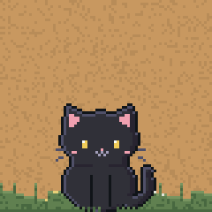
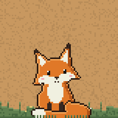
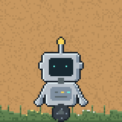
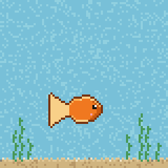
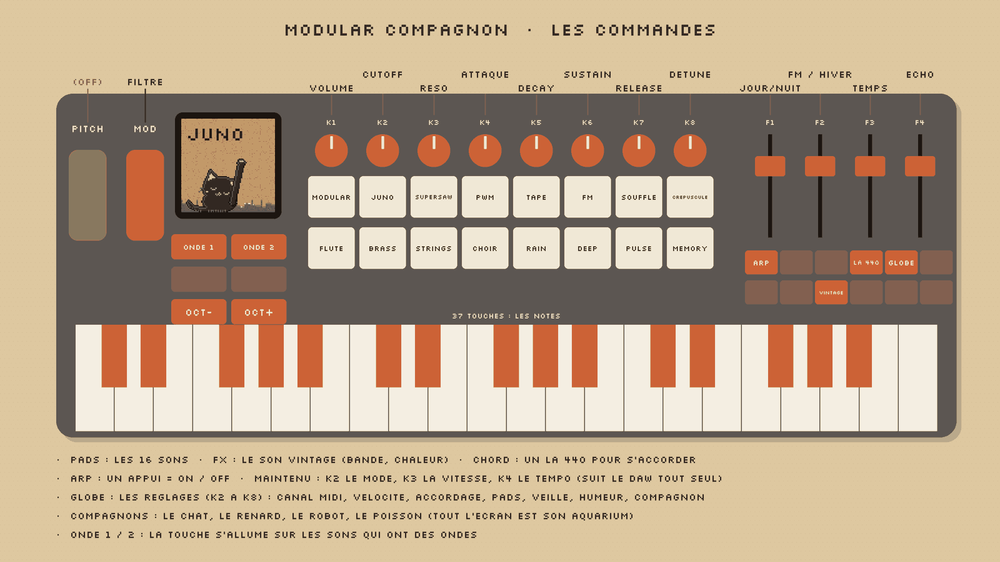
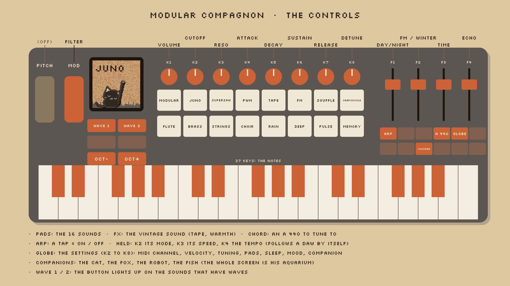

# Modular Compagnon

[](LICENSE)

   

**FR** · Un firmware libre pour le **M-VAVE SMK-37 Elite**, par [Bungle Society](https://www.youtube.com/@bunglesociety).
Seize sons de Modular Town, un arpégiateur qui suit ton DAW, et un petit compagnon qui vit dans l'écran : un chat noir,
un renard, un petit robot de Modular Town ou un poisson rouge. Pas de banques, pas de sous-menus : une commande, un rôle.

**EN** · A free firmware for the **M-VAVE SMK-37 Elite**, by [Bungle Society](https://www.youtube.com/@bunglesociety).
Sixteen Modular Town sounds, an arpeggiator that follows your DAW, and a little companion who lives in the screen: a
black cat, a fox, a little Modular Town robot or a goldfish. No banks, no submenus: one control, one job.

- **Installer · Install:** [bunglesociety.github.io/modular-compagnon/install](https://bunglesociety.github.io/modular-compagnon/install/)
  (Chrome or Edge, a USB cable, nothing else)
- **Page:** [bunglesociety.github.io/modular-compagnon](https://bunglesociety.github.io/modular-compagnon/)
- **Firmware:** `modular-compagnon-VERSION.fwsc` in the [Releases](https://github.com/bunglesociety/modular-compagnon/releases)
- Its big brother on the M-VAVE FM-1: [Modular One](https://bunglesociety.github.io/modular-one/)

## Les commandes · The controls





| | FR | EN |
|---|---|---|
| 16 pads | Les seize sons : Modular, Juno, Supersaw, PWM, Tape, FM, Souffle, Crépuscule · Flute, Brass, Strings, Choir, Rain, Deep, Pulse, Memory | The sixteen sounds |
| K1 | Volume | Volume |
| K2 – K8 | Cutoff, résonance, attaque, decay, sustain, release, detune | Cutoff, resonance, attack, decay, sustain, release, detune |
| F1 | Jour / nuit (le jour en haut) | Day / night (day at the top) |
| F2 | FM, l'hiver (la Montée sur Souffle et Crépuscule) | FM, the winter (the Rise on Souffle and Crépuscule) |
| F3 · F4 | Temps de l'écho (libre ; il glisse comme un écho analogique) · écho | Echo time (free; it glides like an analog delay) · echo |
| Knob bank · Fader bank | Onde 1 · onde 2 (la touche s'allume sur les sons qui en ont) | Wave 1 · wave 2 (the button lights up on the sounds that have them) |
| Oct − / + | L'octave | Octave |
| Arp | Un appui : on / off. Maintenu : K2 le mode, K3 la vitesse, K4 le tempo. Suit l'horloge MIDI d'un DAW tout seul (USB ou TRS) | A tap: on / off. Held: K2 the mode, K3 the speed, K4 the tempo. Follows a DAW's MIDI clock by itself (USB or TRS) |
| Chord | Un LA 440 pour accorder un instrument (un deuxième appui l'arrête) | An A 440 to tune an instrument to (press again to stop) |
| FX | Le vintage : pleurage de bande, saturation, aigus adoucis | Vintage: tape wow, saturation, softened highs |
| Globe | Réglages (K2 à K8) : canal MIDI, vélocité, accordage, lumière des pads, veille, humeur, compagnon | Settings (K2 to K8): MIDI channel, velocity, tuning, pad light, sleep, mood, companion |
| Molettes · Wheels | La modulation fait onduler le filtre ; le pitch est désactivé | Modulation waves the filter; pitch is off |

Repeat, Scale, Play, Rec, `<` `>` : rien · nothing.

## Les compagnons · The companions

Au démarrage, BUNGLE SOCIETY descend ; le compagnon dort, puis se réveille. Il tourne la tête vers ce que tu touches,
écoute quand tu joues et vit sa vie quand tu le laisses tranquille. La nuit (F1 en bas), il s'endort, même si tu joues,
jusqu'à ce que le jour revienne. On le choisit dans GLOBE, K8 (COMPANION) ; MOOD (K7) le rend plus calme.

At power-on BUNGLE SOCIETY comes down; the companion sleeps, then wakes up. He turns his head to whatever you touch,
listens when you play and lives his life when you leave him alone. At night (F1 down) he falls asleep, even while you
play, until day comes back. Pick him in GLOBE, K8 (COMPANION); MOOD (K7) makes him calmer.

- **CAT** · toilette patte levée, griffes, roulades, chasse, la folie · leg-up wash, claws, rolls, hunting, the zoomies
- **FOX** · la souris dans l'herbe (le bond, le plongeon), il se gratte, creuse, dort en boule · the mouse in the grass (the
  leap, the dive), scratching, digging, sleeping curled up
- **ROBOT** · danse, tête qui tourne, radio, goutte d'huile, se recharge le soir · dancing, a spinning head, the radio, a
  drop of oil, recharging at night
- **FISH** · tout l'écran est son aquarium : bulles, flocons, loopings, un bisou contre la vitre · the whole screen is his
  aquarium: bubbles, flakes, loops, a kiss on the glass

## Installer · Install

1. **FR** · Branche le SMK-37 Elite en USB, ouvre [l'installeur](https://bunglesociety.github.io/modular-compagnon/install/)
   dans Chrome ou Edge, clique *Installer* et autorise le MIDI. Ne débranche pas pendant l'écriture.
   **EN** · Plug the SMK-37 Elite in by USB, open [the installer](https://bunglesociety.github.io/modular-compagnon/install/)
   in Chrome or Edge, click *Install* and allow MIDI. Don't unplug while it writes.
2. **Retour d'origine · Back to stock:** the installer's last section takes M-VAVE's own *SMK-37 Elite version 016* file
   (checked by its SHA-256) and puts it back. Keep a copy of that file.

The installer only writes the firmware's own areas; the keyboard's boot, identity and calibration are never touched.
Modular Compagnon starts clean every time: nothing of a former Felucca session or of its display settings carries over.
Installing is at your own risk. Only the **Elite** model is supported.

## Construire · Build

Built on [Felucca](https://github.com/hugelton/Felucca) 1.6.1 by Leo Kuroshita ([Hügelton Instruments](https://hugelton.com)),
its SMK-37 board layer. See [BUILDING.md](BUILDING.md) for the toolchain (the JieLi AC79 SDK is not in this tree), then:

```sh
BOARD=smk37 MODEL=elite ./build.sh          # -> build/modular-compagnon-smk37-elite.fwsc
tests/run_tests.sh
cc -O1 -w -DMODULAR_ONE=1 -DFELUCCA_SLICE=0 -Ibuild/gen -Ifirmware/src -Itests -o build/host/m1_shots tests/m1_shots.c -lm
build/host/m1_shots build/shots && python3 tools/make_compagnon_img.py build/shots web/compagnon/img   # the screen pictures
python3 tools/make_controls_img.py          # the controls picture
python3 tools/make_m1_installer.py build/modular-compagnon-smk37-elite.fwsc Modular-Compagnon.html 1.0   # one-file installer
python3 tools/make_compagnon_site.py build/modular-compagnon-smk37-elite.fwsc 1.0 site/                  # GitHub Pages
```

The Modular Compagnon code: `firmware/src/m1_ui.c` (the controls, GLOBE, the ARP), `firmware/src/m1_draw.c` (the screen,
the companions' life), `firmware/src/eng_ville.c` (the sounds), `firmware/src/fx.c` (the echo's glide, the vintage, the
A 440), `tools/gen_pets.py` and `tools/gen_cat.py` (the companions' pictures), `tools/gen_pixfont.py`, `web/compagnon/`.

## Licence · License

GPL-3.0-only, like Felucca: [LICENSE](LICENSE), [LICENSING.md](LICENSING.md), [LICENSES/](LICENSES/), [CREDITS.md](CREDITS.md).
The pixel font is [Silkscreen](https://github.com/googlefonts/silkscreen) by Jason Kottke (SIL OFL 1.1).
Felucca's own README: [README-FELUCCA.md](README-FELUCCA.md).

Not affiliated with M-VAVE. SMK-37 is their product name, used only to say which keyboard this runs on.

© 2026 Alexis Arakis · Bungle Society
